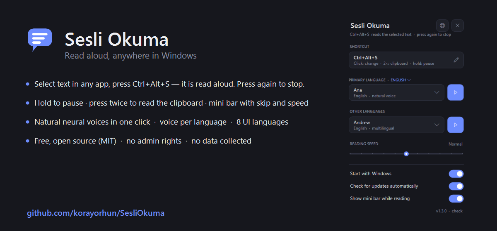
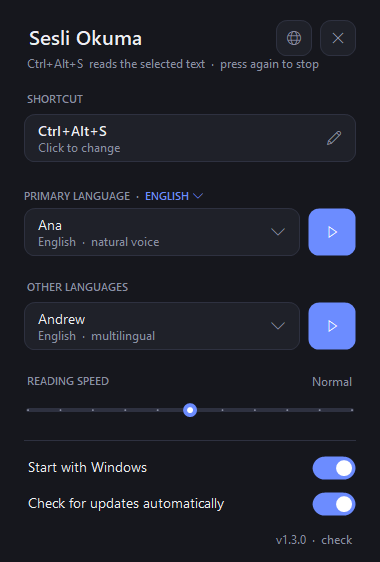
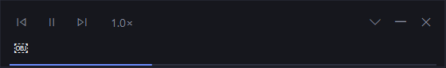
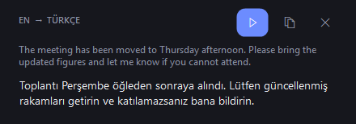
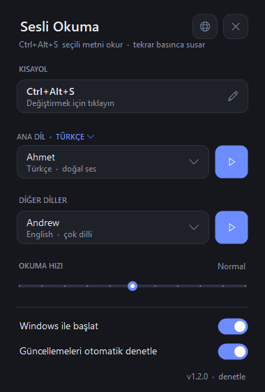

<p align="center"></p>

<p align="center">
<a href="https://github.com/korayorhun/SesliOkuma/releases/latest"></a>
<a href="https://github.com/korayorhun/SesliOkuma/releases"></a>
<a href="LICENSE.txt"></a>
<a href="https://github.com/sponsors/korayorhun"></a>
</p>

**English** · [Türkçe](#türkçe)

# Sesli Okuma

**Sesli Okuma** (Turkish for "read aloud") is a tiny Windows 10/11 tray tool: **select text in any application and press a shortcut** (default `Ctrl + Alt + S`) to hear it read aloud — press again to stop. Click the tray icon for a minimal panel with the shortcut, voices per language, reading speed and interface language.

<p align="center"></p>
<p align="center"></p>
<p align="center"></p>

## Highlights

- **One shortcut, three gestures** — press: read the selection (or the paragraph under the mouse when nothing is selected) / stop; press twice: read the clipboard; hold: pause / resume.
- **Mini bar while reading** — a thin bar at the bottom of the screen shows the current sentence with pause, previous/next sentence and speed; it disappears when reading ends (can be turned off).
- **Translate & read** — a second shortcut (default `Ctrl + Alt + T`) translates the selection into your primary language, shows original + translation in a small card and reads the translation aloud. Works out of the box with the free MyMemory service (no account; ~5,000 characters/day); an optional DeepL key under *Advanced* gives better translations.
- **Read from screen (OCR)** — `Ctrl + Alt + R` freezes the screen: drag over any area, or press **Enter** for the whole window, and the OCR built into Windows reads text that cannot be selected (images, scanned PDFs, remote desktops, videos). Offline and free; if your language's OCR pack is missing, one click adds it.
- **Reading shortcuts** — while reading, `Ctrl + Alt + ←/→` jumps to the previous/next sentence and `Ctrl + Alt + ↑/↓` changes the speed. They exist only while something is being read, so they never clash with other apps (can be turned off).
- **Queue and resume** — press the shortcut twice while reading to queue the selection; it plays when the current text ends. A long text you stopped continues where you left off the next time you read it (re-reading it right away starts from the top).
- **Reads like a person, not a parser** — a speech layer sits between the screen and the voice: list bullets become pauses instead of "bullet", `25°C` is read as degrees, `m²` and `€` get their words, emoji are skipped, ALL-CAPS words are read as words (abbreviations still spelled), and English words inside Turkish text ("Netcad", "download") get a Turkish pronunciation from a built-in dictionary. Your own `okunus.txt` dictionary (*Advanced → Edit pronunciation dictionary*) overrides everything; the highlight still follows the original words.
- **Small comforts** — remaining time on the reading bar, optional *lower other sounds while reading* (crash-safe: volumes are always restored), and *Copy error log* in About for one-click bug reports.
- **Works everywhere** — browsers, Office, PDF readers, chat apps, IDEs. Text is taken through UI Automation; apps that don't expose it fall back to a transparent copy that restores your clipboard.
- **Natural voices in one click** — the panel offers to install the open-source [NaturalVoiceSAPIAdapter](https://github.com/gexgd0419/NaturalVoiceSAPIAdapter), adding Microsoft's online neural voices (Turkish *Emel/Ahmet*, English *Andrew/Ava/Aria…*, and multilingual voices). Windows voice packs can be added from the panel too.
- **Local Turkish neural voice (offline)** — one card in the panel downloads **Ema**, a fully offline natural Turkish voice built on [EMA Lightning](https://huggingface.co/canberkkkkkk/ema-lightning) (Canberk Aslan, Apache-2.0) with [normalizer-tr](https://github.com/erdemtuna/normalizer-tr) (Erdem Tuna, Apache-2.0) and ONNX Runtime, via [ema-lightning-dotnet](https://github.com/korayorhun/ema-lightning-dotnet). It becomes the default Turkish voice, reads ~20x faster than real time on CPU, keeps the word highlight, and English words inside Turkish text are adapted so they sound right. No internet, no account.
- **Voice per language** — the script/language of the selected text is detected; primary-language text uses your primary voice, everything else your second voice.
- **8 interface languages** — English, Türkçe, 中文, हिन्दी, Español, Français, العربية, Português. Switch instantly; the installer speaks them too.
- **Your shortcut** — click the field, press a combination; conflicts are reported and the old shortcut kept.
- **Auto-update** — daily check against GitHub Releases, SHA-256-verified download, silent install, restart. Can be turned off.
- **Accessibility extras** (under *Advanced*) — *read what the mouse points at*: rest the pointer on any button or text and it is spoken; high-contrast Windows themes are honored; a tiny words-read counter.
- **Respectful** — per-user install, no admin rights, **no telemetry**; text goes only to the Windows speech provider (SAPI) you choose. MIT licensed.

## Accessibility

Sesli Okuma is built to work well for blind and low-vision users, following a screen-reader-first approach:

- **Screen reader friendly** — every control in the panel exposes a proper name and state to Narrator, NVDA and JAWS; the whole panel is fully keyboard-operable (Tab / Space / Enter / arrows, visible focus ring).
- **Accessibility mode** (tray menu or *Advanced*) — optional spoken status cues through the app's own voice for events that have no window: "no text to read", paused / resumed, speed and voice changes. Off by default so it never talks over your screen reader; switching it on or off takes one click and does not change anything else.
- **"Read the shortcuts"** — with accessibility mode on, the tray menu can speak the full shortcut guide.
- Everything works from global hotkeys; no mouse needed: one shortcut reads, double-press reads the clipboard (or queues the selection while reading), holding it pauses and resumes; `Ctrl + Alt + arrows` move by sentence and change the speed while reading.
- **Screen OCR without a mouse** — `Ctrl + Alt + R`, then **Enter**, reads the whole active window, including apps that expose nothing to screen readers.
- **Welcome for screen-reader users** — when Narrator, NVDA or JAWS is running on first start, Sesli Okuma introduces itself and its shortcut once, by voice.
## Install

**Try the Turkish voice first, right in your browser:** https://korayorhun.github.io/SesliOkuma/demo/ (runs locally in the browser; also on [Hugging Face](https://huggingface.co/spaces/korhun/turkce-dogal-ses)).

The quickest way, built into Windows 10/11:

```
winget install KorayOrhun.SesliOkuma
```

[Scoop](https://scoop.sh) users: `scoop bucket add korayorhun https://github.com/korayorhun/scoop-bucket` then `scoop install korayorhun/sesliokuma` (portable; updates arrive through `scoop update`).

Or download the latest `SesliOkuma-Setup-x.y.z.exe` (or the portable `SesliOkuma-Portable-x.y.z.zip` — unzip and run, nothing else) from **[Releases](https://github.com/korayorhun/SesliOkuma/releases/latest)** and run it (no admin rights). The package is not code-signed yet, so SmartScreen may show "unrecognized app": *More info → Run anyway*.

| Action | How |
|---|---|
| Read selected text | select text → `Ctrl + Alt + S` (or your shortcut) |
| Stop | press the shortcut again (or tray icon → Stop) |
| Pause / resume | hold the shortcut ~1 s, or the mini bar |
| Translate & read | `Ctrl + Alt + T` — free, no setup; optional DeepL key for better quality |
| Read clipboard | press the shortcut twice |
| Settings | click the tray icon (or run the exe again) |
| Interface language / About | globe icon in the panel |
| Save as audio (WAV) | tray icon → right-click → Save selection as audio file |
| Read a text file | right-click a `.txt` / `.md` file in Explorer → *Read with Sesli Okuma* |
| Quit | tray icon → right-click → Exit |

## Build from source

No SDK needed — the C# compiler shipped with .NET Framework 4.8 is enough:

```powershell
.\build.ps1                  # src\*.cs -> SesliOkuma.exe (and start it)
.\release.ps1 -Version 1.3.0 # bump, build, installer, tag, GitHub release
```

The installer needs [Inno Setup 6](https://jrsoftware.org/isinfo.php) (`installer\SesliOkuma.iss`; copy the unofficial `Hindi.islu` into Inno's `Languages` folder for Hindi).

## Support

If Sesli Okuma saves you time, a one-time coffee via **[GitHub Sponsors](https://github.com/sponsors/korayorhun)** is appreciated — no strings attached. Bug reports and ideas: [Issues](https://github.com/korayorhun/SesliOkuma/issues) · [Discussions](https://github.com/korayorhun/SesliOkuma/discussions).

---

# Türkçe

Windows 10/11 için küçük bir sistem tepsisi aracı: **herhangi bir uygulamada seçtiğiniz metni bir kısayolla sesli okur** (varsayılan `Ctrl + Alt + S`), tekrar basınca susar. İkona tıklayınca açılan minimal panelden kısayolu, ana dili ve sesleri, okuma hızını ve arayüz dilini seçersiniz.

<p align="center"></p>

- **Tek kısayol, üç jest** — bas: seçimi (seçim yoksa imlecin altındaki paragrafı) oku / sustur; iki kez bas: panoyu oku; basılı tut: duraklat / devam.
- **Okurken mini şerit** — ekranın altında ince bir çubuk: okunan cümle, duraklat, önceki/sonraki cümle, hız; okuma bitince kaybolur (kapatılabilir).
- **Çevir ve oku** — ikinci kısayol (varsayılan `Ctrl + Alt + T`) seçimi ana dilinize çevirir, küçük bir kartta orijinal + çeviriyi gösterir ve çeviriyi okur. Kurulum gerekmez: ücretsiz MyMemory servisi (hesapsız, günde ~5.000 karakter); daha iyi çeviri isteyenler *Gelişmiş* altına isteğe bağlı DeepL anahtarı girebilir.
- **Ekrandan oku (OCR)** — `Ctrl + Alt + R` ekranı dondurur: okunacak alanı sürükleyin ya da tüm pencere için **Enter**'a basın; Windows'un yerleşik OCR'ı seçilemeyen yazıları okur (resimler, taranmış PDF'ler, uzak masaüstü, videolar). Çevrimdışı ve ücretsiz; dilinizin OCR paketi eksikse tek tıkla eklenir.
- **Okuma kısayolları** — okuma sürerken `Ctrl + Alt + ←/→` önceki/sonraki cümle, `Ctrl + Alt + ↑/↓` hız. Yalnız okuma sırasında etkindir, başka programlarla çakışmaz (kapatılabilir).
- **Sıra ve kaldığı yerden devam** — okuma sürerken kısayola iki kez basmak seçimi sıraya ekler; mevcut metin bitince o okunur. Yarıda durdurduğunuz uzun metni sonra tekrar okuttuğunuzda kaldığı yerden devam eder (hemen tekrar okutursanız baştan başlar).
- **Makine gibi değil, insan gibi okur** — ekranla ses arasında bir konuşma katmanı var: madde imleri "nokta işareti" yerine duraklama olur, `25°C` "yirmi beş santigrat derece" diye okunur, `m²` ve `€` sözcüğe dönüşür, emoji atlanır, BÜYÜK HARFLİ kelimeler harf harf değil sözcük olarak okunur (kısaltmalar yine harf harf), Türkçe metindeki İngilizce kelimeler ("Netcad", "download") yerleşik sözlükten Türkçe okunuş alır. Kendi `okunus.txt` sözlüğünüz (*Gelişmiş → Okunuş sözlüğünü düzenle*) her şeyin önüne geçer; vurgu yine orijinal kelimeyi izler.
- **Küçük konforlar** — okuma çubuğunda kalan süre, isteğe bağlı *okurken diğer sesleri kıs* (çökmeye dayanıklı: sesler her zaman geri gelir) ve Hakkında'da tek tıkla *hata kaydını kopyala*.
- **Her yerde çalışır** — tarayıcı, Office, PDF, sohbet, IDE. Metin UI Automation ile alınır; vermeyen uygulamalarda panonuzu geri yükleyen şeffaf bir kopyalama yoluna düşer.
- **Doğal sesler tek tıkla** — panel, açık kaynak [NaturalVoiceSAPIAdapter](https://github.com/gexgd0419/NaturalVoiceSAPIAdapter)'ı kurmayı önerir: Emel, Ahmet ve 15+ İngilizce neural ses, çok dilli sesler (internet gerekir). Windows ses paketleri de panelden eklenir.
- **Yerel Türkçe doğal ses (çevrimdışı)** — paneldeki kart, tamamen çevrimdışı çalışan doğal Türkçe ses **Ema**'yı indirir: [EMA Lightning](https://huggingface.co/canberkkkkkk/ema-lightning) (Canberk Aslan, Apache-2.0) + [normalizer-tr](https://github.com/erdemtuna/normalizer-tr) (Erdem Tuna, Apache-2.0) + ONNX Runtime, [ema-lightning-dotnet](https://github.com/korayorhun/ema-lightning-dotnet) üzerinden. Varsayılan Türkçe ses olur, kelime vurgusu aynen çalışır; Türkçe metindeki İngilizce kelimeler de doğru okunacak biçimde uyarlanır. İnternet ve hesap gerektirmez.
- **Dile göre ses** — seçili metnin dili algılanır; ana dil metinleri ana dil sesiyle, diğerleri ikinci sesle okunur.
- **8 arayüz dili**, **kendi kısayolunuz**, **otomatik güncelleme** (SHA-256 doğrulamalı, kapatılabilir).
- Kurulum yönetici yetkisi istemez; **veri toplamaz**. Ayarlar ve günlük: `%LOCALAPPDATA%\SesliOkuma\`.

**Dosya oku:** Explorer'da bir `.txt` / `.md` dosyasına sağ tık → *Sesli Okuma ile oku*. **Erişilebilirlik** (Gelişmiş): fareyle üzerine gelince oku, yüksek kontrast desteği, okunan kelime sayacı. **Taşınabilir sürüm:** Releases'ta zip.

**Önce tarayıcıda deneyin:** https://korayorhun.github.io/SesliOkuma/demo/ (Türkçe ses doğrudan tarayıcınızda çalışır).

**Kurulum:** en kolayı, Windows'ta hazır gelen winget ile — Komut İstemi'ne `winget install KorayOrhun.SesliOkuma` yazın. Ya da [Releases](https://github.com/korayorhun/SesliOkuma/releases/latest) sayfasından `SesliOkuma-Setup-x.y.z.exe`. İmzasız olduğu için SmartScreen uyarısı çıkabilir: *Ek bilgi → Yine de çalıştır*.

**Ses dosyasına kaydet:** tepsi ikonu → sağ tık → "Seçimi ses dosyasına kaydet" (WAV).

**Hakkında & destek:** dil menüsünün altındaki *Hakkında* kartında kaynak kod, sürüm notları, sorun bildirme ve isteğe bağlı **Destek ol ♥** (GitHub Sponsors, tek seferlik) bulunur.

## Erişilebilirlik

Sesli Okuma, görme engelli kullanıcılar için ekran okuyucu öncelikli yaklaşımla geliştirilmiştir:

- **Ekran okuyucu dostu** — paneldeki her denetim Narrator/NVDA/JAWS'a doğru ad ve durum bildirir; panel tamamen klavyeyle kullanılabilir (Tab / Boşluk / Enter / oklar, görünür odak çerçevesi).
- **Erişilebilirlik modu** (tepsi menüsü veya *Gelişmiş*) — penceresi olmayan olaylar için isteğe bağlı sesli durum bildirimi: "okunacak metin bulunamadı", duraklatıldı / devam, hız ve ses değişimi. Varsayılan olarak kapalıdır; ekran okuyucunuzun üstüne konuşmaz. Açıp kapatmak tek tıktır ve başka hiçbir davranışı değiştirmez.
- **"Kısayolları oku"** — mod açıkken tepsi menüsünden tüm kısayol rehberi sesli dinlenebilir.
- Her şey küresel kısayollarla çalışır; fare gerekmez: tek kısayol okur, çift basış panoyu okur (okuma sürerken seçimi sıraya ekler), basılı tutmak duraklatır/sürdürür; okurken `Ctrl + Alt + oklar` cümle atlar ve hızı değiştirir.
- **Faresiz ekran OCR'ı** — `Ctrl + Alt + R` ardından **Enter**, ekran okuyuculara hiçbir şey sunmayan uygulamalar dahil tüm etkin pencereyi okur.
- **Ekran okuyucu kullanıcılarına karşılama** — ilk açılışta Narrator, NVDA veya JAWS çalışıyorsa Sesli Okuma kendini ve kısayolunu bir kez sesli tanıtır.
## Lisans

MIT — bkz. [LICENSE.txt](LICENSE.txt).